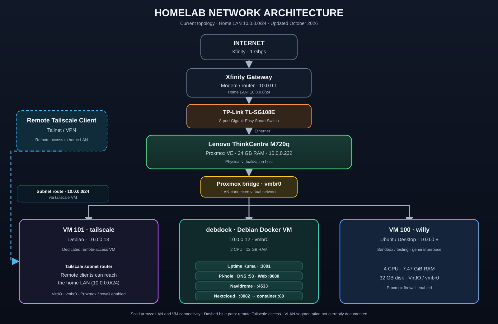

# Lab Architecture

This directory contains the current physical and logical architecture of the homelab.

## Current network diagram

The Xfinity gateway provides the `10.0.0.0/24` home LAN. The Lenovo ThinkCentre M720q runs Proxmox VE and connects its virtual machines to that LAN through `vmbr0`. Three active VMs are documented: `tailscale` (`10.0.0.13`), `debdock` (`10.0.0.12`), and `willy` (`10.0.0.8`). The Docker VM `debdock` hosts Uptime Kuma, Pi-hole, and Navidrome. Tailscale provides remote access to the home LAN.

The diagram is also available as an editable [draw.io file](./homelab-network-diagram-fixed.drawio) and as an [SVG source](./network-diagram.svg).

## Current components

- Xfinity 1 Gbps Internet and modem/router (`10.0.0.1`)
- Lenovo ThinkCentre M720q running Proxmox VE with 24 GB RAM (`10.0.0.232`)
- Proxmox Linux bridge `vmbr0` on `10.0.0.0/24`
- Debian VM `tailscale` for remote access
- Debian Docker VM `debdock` for Uptime Kuma, Pi-hole, and Navidrome
- Ubuntu Desktop VM `willy` for sandboxing and testing

See [`../networking/ip-addressing.md`](../networking/ip-addressing.md) for the recorded addresses and [`../proxmox/vm-inventory.md`](../proxmox/vm-inventory.md) for VM details.

## Planned improvements

- VLAN segmentation and dedicated management, server, guest, and IoT networks
- Firewall implementation and rules
- Network monitoring, centralized logging, and DNS documentation
- Additional virtualization hosts and automated infrastructure deployment
